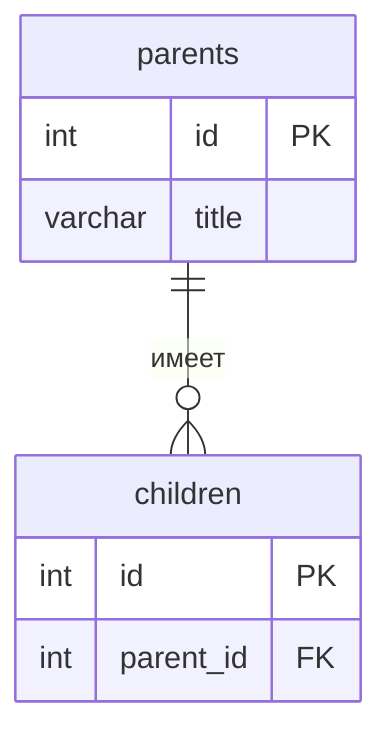

<!--
  Это шаблон. После создания своего репозитория:
  1. Переименуй репозиторий в backend-<фамилия>-<тема>, например backend-ivanova-habits.
  2. Заполни разделы ниже под свою тему и удали этот комментарий.
  Задания лаб — в папке docs/.
-->

# Название проекта

Тема №__ из колеса: **...**. Одна фраза: что это и для кого.

| | |
| --- | --- |
| Главная сущность | ... |
| Связанная сущность (1:N) | ... |
| Фишка | ... |
| Стек | язык, фреймворк, БД |

## Как запустить

```bash
# команды по шагам: от git clone до работающего сервиса
```

Сервис слушает `http://localhost:8000`. Запросы для демонстрации — в `requests.http`.

## Эндпоинты

| Метод | Путь | Что делает | Ответ |
| --- | --- | --- | --- |
| GET | `/health` | Проверка, что сервис жив | 200 `{"status":"ok"}` |
| POST | `/api/items` | Создать | 201 + объект с `id`; 400 при ошибке |
| GET | `/api/items` | Список | 200 |
| GET | `/api/items/{id}` | Получить | 200; 404 |
| PATCH | `/api/items/{id}` | Изменить | 200; 400; 404 |
| DELETE | `/api/items/{id}` | Удалить | 204; 404 |

## ER-диаграмма

<!-- С лабы 2. Mermaid рисуется прямо на GitHub. -->



## Интерфейс

<!-- С лабы 4: скриншот, например  -->
