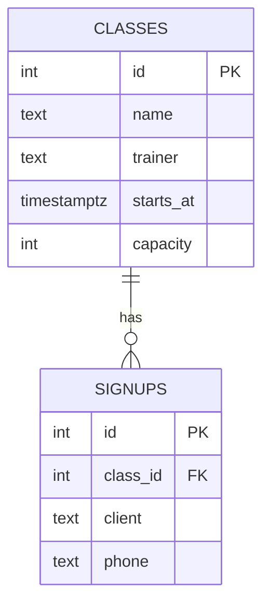

# Фитнес-клуб

Тема №18: **Фитнес-клуб**. HTTP-сервис для управления расписанием групповых занятий фитнес-клуба.

| | |
| --- | --- |
| Главная сущность | Групповое занятие |
| Связанная сущность (1:N) | Запись клиента на занятие |
| Фишка | Фильтрация по названию и тренеру, пагинация, структурированные JSON-логи |
| Стек | Go 1.26, `net/http`, PostgreSQL 18, pgx, goose |

## Модель занятия

| Поле | Тип | Описание |
| --- | --- | --- |
| `id` | integer | Уникальный идентификатор, назначается сервером |
| `name` | string | Название занятия |
| `trainer` | string | Имя тренера |
| `starts_at` | string | Дата и время начала в формате RFC 3339 |
| `capacity` | integer | Число мест, должно быть больше нуля |

Пример:

```json
{
  "id": 1,
  "name": "Йога",
  "trainer": "Анна",
  "starts_at": "2026-11-02T18:30:00+10:00",
  "capacity": 15
}
```

## Схема базы данных



Внешний ключ `signups.class_id` использует `ON DELETE CASCADE`: при удалении занятия удаляются и все записи на него.

## Индексы

Миграция `20261106061000_add_signup_indexes.sql` создаёт индекс `idx_signups_class_id` для частого запроса списка записей одного занятия. Проверка на тестовом наборе из 10 000 записей:

```sql
EXPLAIN (COSTS OFF)
SELECT id, class_id, client, phone
FROM signups
WHERE class_id = -42
ORDER BY id;
```

```text
Sort
  Sort Key: id
  ->  Index Scan using idx_signups_class_id on signups
        Index Cond: (class_id = '-42'::integer)
```

## Правила записи

Проверка и создание записи выполняются в одной транзакции с блокировкой занятия через `SELECT ... FOR UPDATE`:

- число записей не может превышать `capacity`;
- один клиент не может записаться на занятие повторно, включая другое написание регистра;
- нарушение правила возвращает `409 Conflict` с объяснением причины.

## Как запустить

Требуется Go 1.26 или новее.

Скопируйте пример переменных окружения и запустите Compose:

```bash
cp .env.example .env
docker compose up --build -d
```

PostgreSQL запускается первым, затем сервис `migrate` применяет миграции goose, после чего запускается backend.

Управление миграциями:

```bash
docker compose run --rm migrate status
docker compose run --rm migrate up
docker compose run --rm migrate down
```

Заполнение пустой базы тестовыми данными:

```bash
docker compose run --rm seed
```

Команда идемпотентна: если в базе уже есть занятия, повторное заполнение пропускается.

Сервис работает на `http://localhost:8000`. Запросы для демонстрации лежат в `requests.http`.

Swagger UI доступен по адресу `http://localhost:8000/docs`, OpenAPI-спецификация — по адресу `http://localhost:8000/openapi.json`.

Запуск тестов:

```bash
go test ./...
```

## Эндпоинты

| Метод | Путь | Что делает | Ответы |
| --- | --- | --- | --- |
| GET | `/health` | Проверяет, что сервис работает | 200 |
| GET | `/docs` | Открывает Swagger UI | 200 |
| GET | `/openapi.json` | Возвращает OpenAPI-спецификацию | 200 |
| POST | `/api/classes` | Создаёт занятие | 201; 400 |
| GET | `/api/classes` | Возвращает список занятий | 200; 400 |
| GET | `/api/classes/stats` | Возвращает занятия по посещаемости | 200 |
| GET | `/api/classes/{id}` | Возвращает занятие по ID | 200; 400; 404 |
| PUT | `/api/classes/{id}` | Полностью заменяет занятие | 200; 400; 404 |
| PATCH | `/api/classes/{id}` | Частично изменяет занятие | 200; 400; 404 |
| DELETE | `/api/classes/{id}` | Удаляет занятие | 204; 400; 404 |
| POST | `/api/classes/{id}/signups` | Записывает клиента на занятие | 201; 400; 404; 409 |
| GET | `/api/classes/{id}/signups` | Возвращает записи на занятие | 200; 400; 404 |

Список поддерживает фильтры и пагинацию:

```http
GET /api/classes?name=Йога&trainer=Иван&limit=10&offset=0
```

- `name` — точное название групповой тренировки
- `trainer` — точное имя тренера
- `limit` — число элементов от 1 до 100
- `offset` — число пропускаемых элементов, начиная с нуля

Поиск по части названия без учёта регистра выполняет PostgreSQL:

```http
GET /api/classes?q=йог
```

Статистика считается одним агрегатным запросом с `LEFT JOIN`, `GROUP BY` и `COUNT`. Занятия сортируются по убыванию количества записей, занятия без записей также присутствуют с `signup_count: 0`.

Ошибки валидации возвращаются в едином формате:

```json
{
  "error": "capacity must be greater than zero",
  "field": "capacity"
}
```

## Логи

Сервис пишет структурированные JSON-логи в stdout. Для каждого HTTP-запроса сохраняются метод, путь, параметры запроса, статус, время выполнения в миллисекундах и размер ответа.

```json
{"time":"2026-10-23T15:47:08.309+10:00","level":"INFO","msg":"http_request","event":"http_request","method":"GET","path":"/api/classes","query":"limit=10","status":200,"duration_ms":0.3}
```
